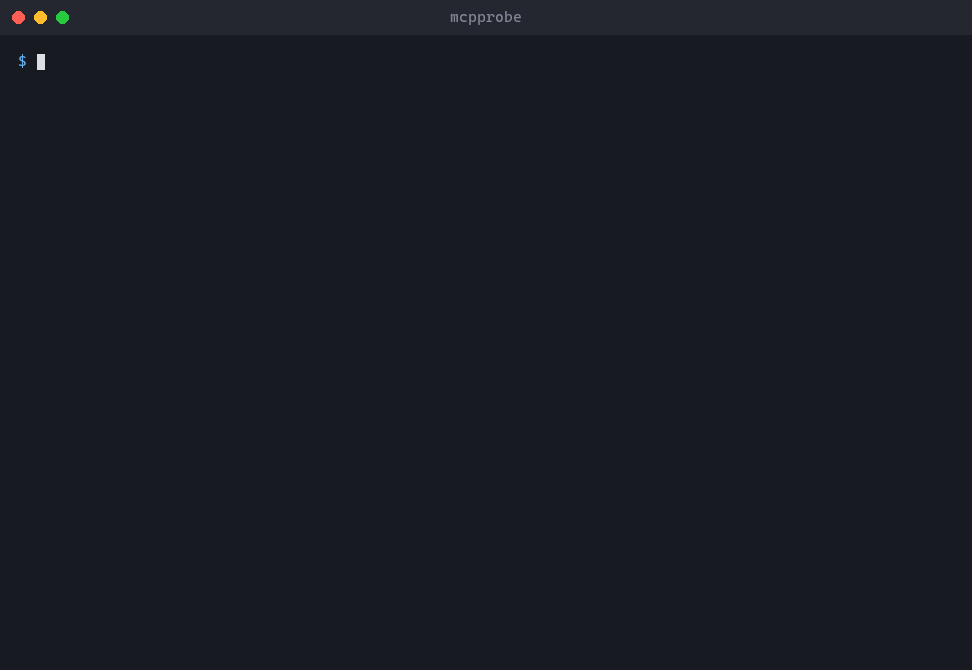

# mcpprobe

Scripted testing, fuzzing and benchmarking for [Model Context Protocol](https://modelcontextprotocol.io) servers, as a CLI and a TypeScript library.



## Features

- Checks the protocol handshake, error handling, tool schemas, resources and prompts.
- Calls tools with valid, invalid and hostile inputs generated from their schemas, and shrinks failing inputs.
- Reports crashes, unhandled errors, leaked stack traces or secrets, and slow calls.
- Only calls read-only tools unless you allow more. Secrets are redacted from output.
- Reproducible runs from a seed, with a ready-to-run `mcpprobe call` command for each failure.
- Connects over stdio, Streamable HTTP or legacy SSE. Reports as console, JSON, JUnit, Markdown or SARIF.

## Installation

```sh
npm install -g @zahid15/mcpprobe   # CLI
npm install @zahid15/mcpprobe      # library
```

## Quick Start

```sh
mcpprobe inspect --stdio "node ./server.js"                # list tools, resources and prompts
mcpprobe test --stdio "node ./server.js"                   # run all checks
mcpprobe fuzz --stdio "node ./server.js" --tool search     # random inputs for one tool
mcpprobe bench --http https://host/mcp --tool search       # latency and throughput
mcpprobe call search --stdio "node ./server.js" --args '{"query":"hello"}'
```

Exit codes: `0` passed, `1` checks failed, `2` invalid command or config, `3` could not connect. Run `mcpprobe <command> --help` for all options. To call tools that are not read-only, use `--allow-tool <name>`, `--allow-unsafe` or `--allow-destructive`, plus `--yes` in CI.

```ts
import { resolveOptions, testServer, formatReport } from "@zahid15/mcpprobe";

const options = resolveOptions({}, { stdio: "node ./server.js" });
const report = await testServer(options);

console.log(formatReport(report, "markdown"));
process.exitCode = report.exitCode;
```

## API

| Function | Returns |
|---|---|
| `resolveOptions(config?, flags?, env?)` | `Options` built from a config object and flags such as `stdio`, `http`, `headers`, `tool`, `seed`, `allowTool` |
| `loadConfig(file?)` | `Promise<Config>` from `mcpprobe.config.{json,yaml,yml}` in the working directory, or the given file |
| `inspect(options)` | `Promise<Report>` with the server inventory in `report.inventory` |
| `testServer(options, strict?)` | `Promise<Report>` from the full check suite |
| `fuzz(options, strict?)` | `Promise<Report>` from fuzzing (`options.runs` per tool) |
| `bench(options, strict?)` | `Promise<Report>` with latency stats in `report.benchmarks` |
| `callTool(options, name, args)` | `Promise<{ result?, report }>` for a single tool call |
| `formatReport(report, format?, color?)` | `string` in `console`, `json`, `junit`, `markdown` or `sarif` format |

A `Report` contains `findings` (each with `status`, `id`, `explanation`, `fix` and an optional `reproduction`), a `summary` count per status, and an `exitCode`. Types are exported: `Report`, `Finding`, `Options`, `Config` and more.

Invalid options throw `UsageError`. Setting `allowUnsafe` or `allowDestructive` also requires `yes: true`.

## Configuration

The CLI reads `mcpprobe.config.yaml` (or `.yml` / `.json`) from the working directory. Flags override it, and `${NAME}` reads an environment variable.

```yaml
defaultTarget: local
allowTool: [lookup_record]
targets:
  local:
    stdio: "node ./server.js"
  staging:
    http: https://host/mcp
    headers:
      Authorization: "Bearer ${TOKEN}"
```

All keys are listed in [mcpprobe.config.example.yaml](mcpprobe.config.example.yaml).

## Compatibility

Node.js 20 or later. The library is ESM only.

## License

[MIT](LICENSE)
